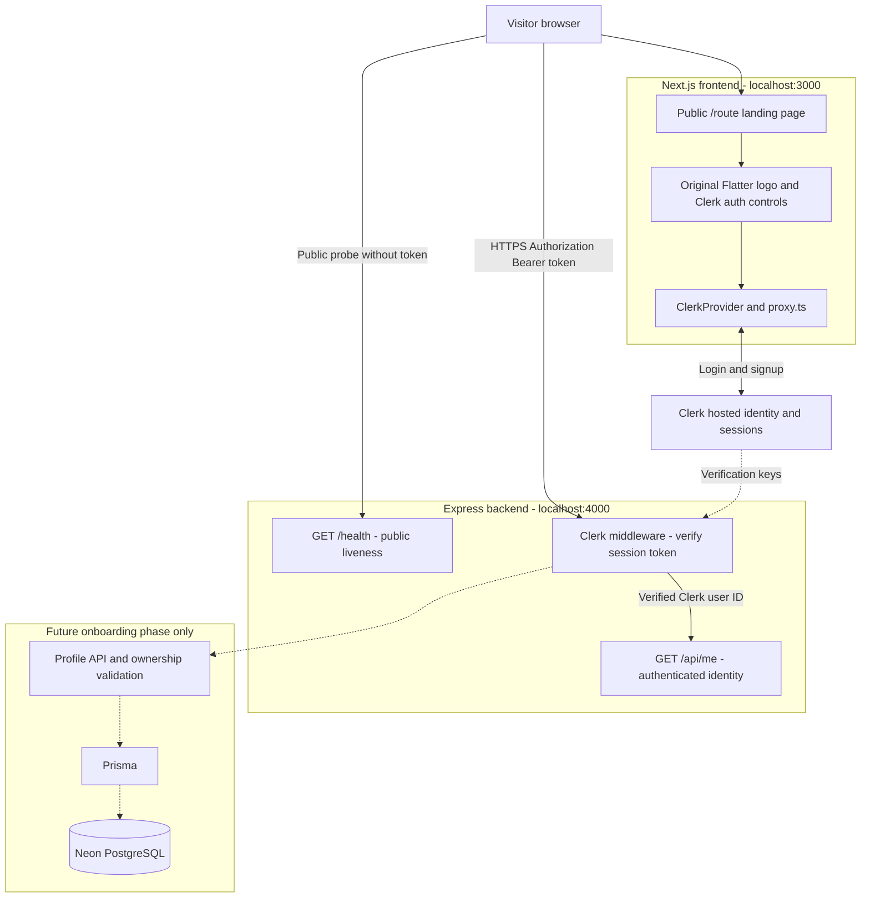
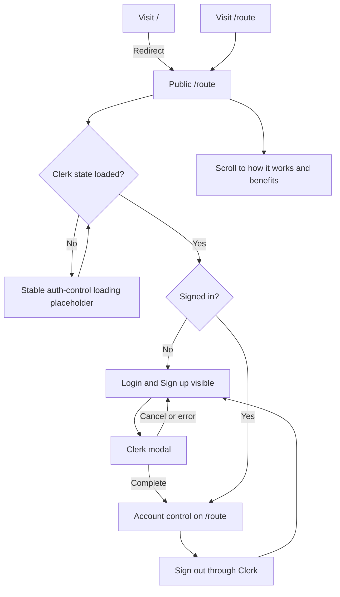
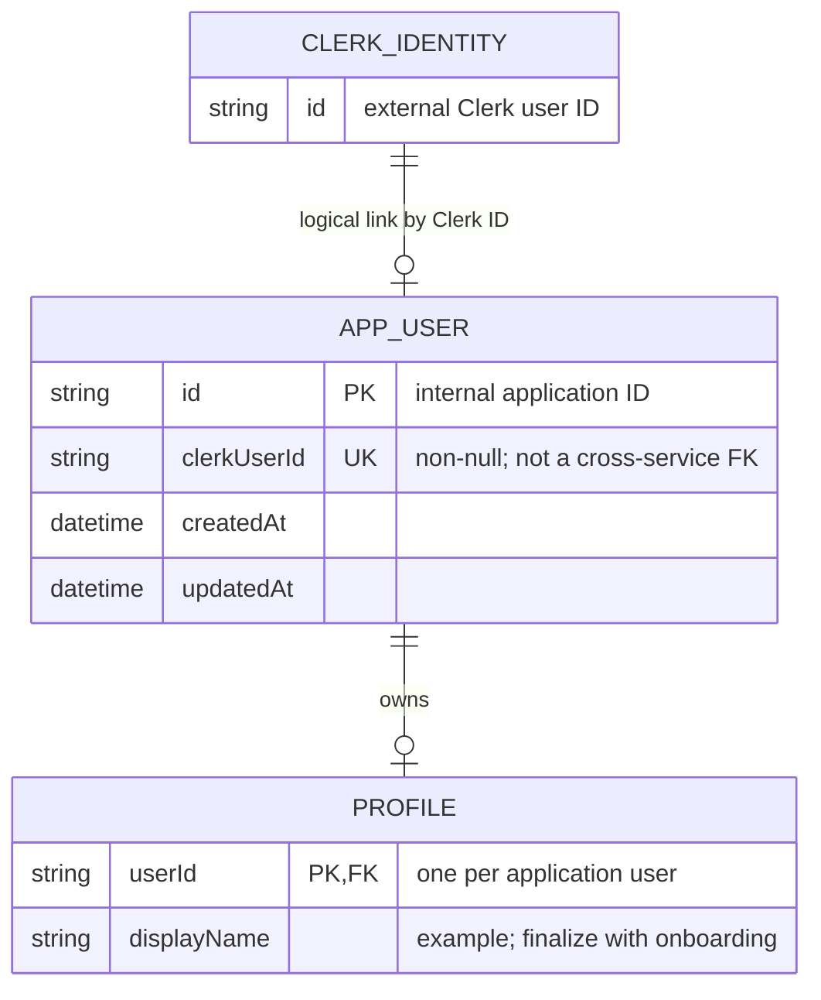
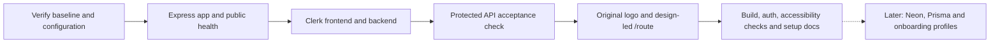

# Flatter architecture and flows

Proposed design only. Solid components are the initial implementation scope; the explicitly marked future data layer is not required for landing/auth/health. See the [implementation plan](./initialization-plan.md) and [visual overview](./architecture.html).

## 1. System architecture and trust boundaries



Only publishable Clerk keys are browser-safe. Next.js/Express keep secret keys server-side. Only Express will access Prisma/Neon. Clerk network calls are not made by the liveness handler. Production uses HTTPS; local development uses HTTP.

## 2. Login/signup and protected API sequence

```mermaid
sequenceDiagram
    actor User
    participant UI as Next.js landing and navbar
    participant Clerk as Clerk
    participant API as Express API
    User->>UI: Open /route
    UI-->>User: Public landing, Login and Sign up
    User->>UI: Click Login or Sign up
    UI->>Clerk: Open prebuilt auth modal
    Clerk-->>User: Verification/authentication steps
    User->>Clerk: Complete required steps
    Clerk-->>UI: Active session
    UI-->>User: Close modal, remain on /route, show account button
    Note over UI,API: Integration acceptance call; no new dashboard required
    UI->>Clerk: getToken()
    Clerk-->>UI: Session token
    UI->>API: GET /api/me with Authorization: Bearer token
    API->>API: Verify session token and allowed party
    alt Valid session
        API-->>UI: 200 with verified clerkUserId
    else Missing, invalid, or expired session
        API-->>UI: 401 JSON Unauthorized
        UI-->>User: Allow login/retry as appropriate
    end
    Note over Clerk,API: No Flatter user row or webhook dependency in this phase
```

Verification keys may be cached by the Clerk SDK; the diagram does not imply a Clerk backend lookup on every API request. Failed/cancelled authentication leaves the visitor on the public landing page.

## 3. Public health sequence

```mermaid
sequenceDiagram
    participant Probe as Browser or health probe
    participant Server as Express server
    participant Health as Public health handler
    Probe->>Server: GET /health, no credentials
    Server->>Health: Route before Clerk middleware
    Health-->>Probe: 200 JSON status ok, service flatter-backend
    Note over Server,Health: No Clerk/Neon request; Cache-Control: no-store
```

This proves the HTTP process responds. Dependency readiness, metrics and a database probe are outside this slice.

## 4. Visitor and authentication flow



## 5. Future application-data relationship

No tables are created in this first slice. This is the minimal intended identity relationship when onboarding is introduced; field types and profile details are finalized then.



Clerk identity and the app user live in separate systems. The relationship is logical, not a PostgreSQL foreign key into Clerk. Lifestyle fields, matching tables, and all other product entities are deliberately deferred.

## 6. Delivery order



No step above has been executed; these are the steps proposed for the subsequent implementation task.

## Final numbered sequence — complete system journey

This consolidates the original landing/auth architecture and the later proposed onboarding extension. Onboarding/database operations below are planned, not implemented. Numbered arrows show execution order; stage labels explain responsibility.

```mermaid
sequenceDiagram
    autonumber
    actor Person
    participant UI as Next.js
    participant Clerk as Clerk
    participant API as Express
    participant DB as Neon through Prisma
    Note over Person,DB: Stage A - public experience and identity
    Person->>UI: Open /route
    UI-->>Person: Landing, unique Flatter logo and auth buttons
    Person->>Clerk: Complete Google or email login/signup through Clerk UI
    alt Authentication cancelled or failed
        Clerk-->>UI: No valid session
        UI-->>Person: Remain on public landing and allow retry
    else Authenticated
        Clerk-->>UI: Active session
        UI->>UI: Enter /auth/continue
        UI->>API: GET /api/onboarding with session bearer token
        API->>API: Verify session and derive the owner
        API->>DB: Read User and its three optional dependent rows
        alt API or database unavailable
            API-->>UI: Retriable error; no assumed onboarding state
            UI-->>Person: Retry or sign out
        else Already complete
            DB-->>API: Existing completion timestamp
            API-->>UI: Completed onboarding state
            UI-->>Person: Skip wizard and return to /route
        else New account or saved draft
            DB-->>API: Missing row or current draft
            API-->>UI: Saved answers, revision and earliest incomplete step
            Note over Person,DB: Stage B - six-step onboarding, detailed in onbaordig.md
            loop Each remaining input step
                UI-->>Person: Intent, About, Housing, Lifestyle or Flatmate preferences
                Person->>UI: Answer and select Continue
                UI->>API: Save section with token and current revision
                API->>API: Validate ownership, eligibility and section values
                API->>DB: Create User on first intent save, or lock/check revision
                API->>DB: Save User or owner-linked section and commit
                DB-->>API: Authoritative saved state
                API-->>UI: New revision and next valid step
                Note over UI,DB: Reject invalid/stale saves; do not advance until committed
            end
            UI-->>Person: Review all sections and choose discovery visibility
            Person->>UI: Finish
            UI->>API: POST complete with revision and visibility
            API->>DB: Lock/check User revision and read all sections
            API->>API: Revalidate the whole persisted draft
            alt Missing answers, ineligible age or conflict
                API->>DB: Roll back transaction
                API-->>UI: Field errors or revision conflict
                UI-->>Person: Preserve input and offer edit/reload
            else Valid completion
                API->>DB: Atomically commit completion and visibility
                API-->>UI: Completed state
                UI-->>Person: Success then /route
            end
        end
    end
    Note over API,DB: Stage C - future product APIs independently require completed, eligible accounts
    Note over Person,DB: Discovery also requires explicit opt-in; listings and match scoring are later work
    Person->>API: Public GET /health
    API-->>Person: Liveness JSON without authentication or database access
```
