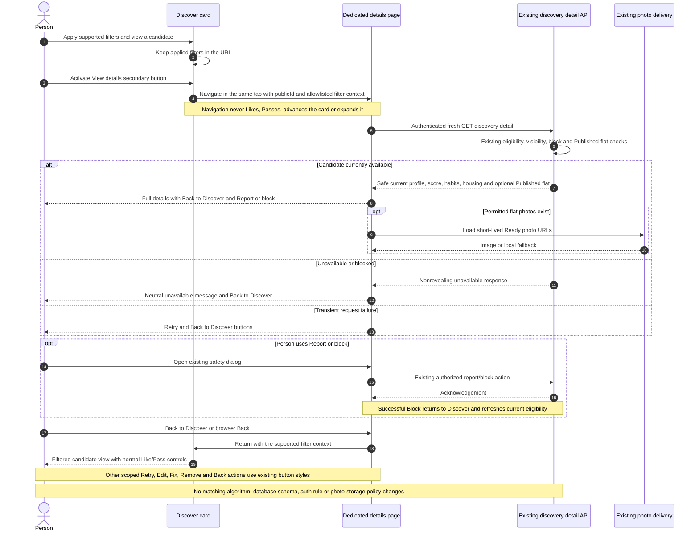

# Discovery details navigation and action UX — implementation handoff

Status: plan prepared for the existing Claude implementation thread. This planning turn changes only this document; the implementation handoff authorizes the frontend work below.

## 1. Requested outcome

**View details opens a dedicated page in the same tab, rather than expanding the swipe card.** Standalone actions elsewhere in the authenticated app should use consistent, accessible button styling instead of plain underlined text.

Interpretation of “next option”: a new routed details screen, not a new browser tab, modal, or additional inline accordion. Preserve the existing matching/privacy rules and the current design direction.

## 2. Current behavior and reuse

- `frontend/src/components/matching/deck.tsx` contains a local `Details` component. Its underlined View details button toggles an inline section and fetches the candidate on expansion.
- The existing `GET /api/discovery/:publicId` already provides fresh, eligibility-checked profile/lifestyle data, compatibility, housing context and permitted Published flat photos. Reuse it; the general profile API has different privacy/data semantics.
- Reuse `DiscoveryDetail`, the authenticated `serverGet`/`api` helpers, current app shell, icons, spinners, `Who`/`Score` presentation where types fit, INR/date helpers, photo fallback and Report/Block dialog.
- Reuse `cta` and `ghost` styles in dashboard blocks and existing form action styles where appropriate. Do not add a button library or a generic configurable component system.
- **Read the current `DESIGN.md`.** It has been changed to a red/neutral Pinterest-inspired system: primary `#e60023`, neutral secondary surfaces, 16px interactive corners, hierarchy through typography and no card shadows. Older docs describing electric-blue branding are historical and must not override it.
- The working tree contains extensive existing/uncommitted UI changes, including preference cards and current design tokens. Preserve them. Do not reset, clean, overwrite whole files from an old baseline or commit unrelated changes.

## 3. Dedicated details page

New route: `/dashboard/discover/[publicId]`, within the existing authenticated `(app)` layout. Existing `/dashboard(.*)` authentication protection covers this path; resource-level authorization remains with the backend.

### Entry and return

1. Replace inline View details with a real Next.js Link styled as a secondary rounded button, optionally with a right-arrow icon. Keep its visible label **View details**.
2. Clicking/tapping/pressing Enter opens the new details route. It must not trigger a Like/Pass, advance the deck, expand the card or start a swipe gesture. Guard the link against the deck's pointer/keyboard handlers; in particular an arrow key on a focused link/button must not accidentally submit a swipe decision.
3. Add a visible **Back to Discover** navigation button on the details page, with a left-arrow icon. Support browser Back as well. Directly opening or refreshing the details URL must work, without requiring a preceding deck visit.
4. Preserve applied discovery filters in the URL using the existing supported filter names: `localities`, `rentMinPaise`, `rentMaxPaise`, `moveInFrom`, `moveInTo`. Initialize the deck's applied filters from the URL and carry those allowlisted values through the details URL/back link. Do not accept an arbitrary external `returnTo` URL.
5. Opening and returning never records a decision. Reuse Next.js back/forward state/scroll behavior where possible. If the deck refetches on return, previously acknowledged decisions remain excluded by the server; do not promise an immutable queue when eligibility/ranking has changed.
6. Do not persist complete profile payloads, budgets, habits or signed photo links in localStorage/sessionStorage just to support Back. No new global state-management dependency or feed-session table.

### Page content

- Header: Back to Discover, candidate identity and current compatibility score.
- Main sections: avatar/initials, name/derived age/occupation, bio, intent, city/locality context, rent/budget and timing, then lifestyle/work-study habits using existing labels.
- For an eligible flat owner: Published flat description, rent/location/setup and Ready photos with the existing missing/expired-image behavior. No Draft/Paused/Closed content or private photo keys.
- Use a single readable column on mobile; use a balanced profile/housing split on wider screens if it fits existing components. Keep typography, spacing, surfaces and radii from the current design rather than introducing another visual style.
- Keep Like/Pass decisions on the Discover deck for this small change. The details page provides Back to Discover and Report or block; do not duplicate the swipe state machine or add new matching features here.
- Preserve Report/Block permission checks and feedback. After a successful block, return to Discover and refetch so that person cannot remain as an actionable cached card. Report-only preserves its existing behavior.

### Loading and failures

Read data freshly using the existing authenticated detail endpoint, with no shared public cache. Use the project's spinner/Suspense and the installed Next.js 16 async route-parameter conventions.

| Result | UI |
| --- | --- |
| Loading | Labelled loading state without a blank flash. |
| 401/403 | Existing sign-in/matching-preference/flat-readiness recovery as appropriate; do not weaken backend checks to show the profile. |
| 404/unavailable/blocked | Neutral “This person is no longer available” state and Back to Discover. Do not explain another person's private exclusion reason. |
| Network/503 | Retry button plus Back to Discover. |
| Missing profile image or failed flat image | Local initials/image fallback; other details stay readable. |

Remove the obsolete inline Details component and imports/state used only by it. Keep the card compact. Do not replace permission-checked data with a stale card payload just to avoid an unavailable state.

## 4. Action audit and replacements

This is a targeted audit of standalone app actions, not removal of all normal links or every occurrence of an underline class.

| Existing location | Action | Planned treatment |
| --- | --- | --- |
| Matching deck | View details | Secondary navigation button to the new route. Remove Hide details toggle. |
| Deck, Matches and viewer-safety component | Report or block | Consistent secondary/tertiary action with shield icon and visible hit area. Preserve dialogs and confirmation behavior. |
| Listing editor | Back to Dashboard | Secondary navigation button with back icon. |
| Listing review | Fix missing field | Small secondary button with its existing accessible field name; still opens the correct editor block. |
| Listing photo queue | Retry / Dismiss | Compact secondary buttons, retaining pending/disabled behavior. |
| Saved listing photos | Remove | Clear labelled removal control. Preserve existing deletion/confirmation/error flow and accessible context. Do not make all surrounding actions red. |
| Flat-photo fallback | Retry | Button that still retries that image only. |
| My Profile and dashboard | Matching preferences | Clear secondary navigation action where it stands alone; preserve nearby explanatory copy. |
| My Profile listing failure | Retry | Secondary navigation/retry action, preserving the existing reload behavior. |
| Owner public-profile preview | Back to My Profile | Secondary navigation button. |
| Onboarding finalization error | Edit affected section | Clear compact secondary navigation controls, preserving error-summary associations and destination step. |

Keep genuine prose/marketing/section-navigation links as links, with the current design's link treatment and accessible hover/focus cues. Do not blindly replace marketing `hover:underline` or make informational text look clickable.

### Interaction rules

- Navigation uses Link/anchor semantics styled as buttons. Local operations use `button type="button"`; actual form submission keeps submit semantics.
- Reuse existing primary/secondary/tertiary styles. Keep brand-red primary actions scarce, reserve subtle neutral controls for View details/Back/Retry and make destructive confirmations unambiguous.
- Minimum effective target 44 × 44px, visible focus, hover/pressed and disabled states, appropriate icon/label spacing and wrapping on narrow screens. Icons do not replace meaningful labels.
- Preserve loading/pending states, validation, retry logic, prevention of double submission and screen-reader announcements. No nested buttons/links, broad click handlers, dead `href="#"` actions or `aria-expanded` on a navigation link.
- No blanket CSS rule removing all underlines: it would hide distinctions on legitimate inline links without fixing button UX.

## 5. Scope and implementation order

1. Re-read current source, relevant AGENTS/design instructions and Next.js local docs. Inspect all deck/action callers and the dirty working tree before editing.
2. Add the dedicated details route and fresh data/error presentation using the existing API. Keep backend eligibility, scoring, data contracts and R2 logic unchanged.
3. Replace the inline expansion and preserve filter navigation/back behavior. Remove obsolete code; add no second details-fetch implementation to the card.
4. Apply the action audit using existing button classes/patterns; verify each action still calls the same operation.
5. Run focused checks and frontend lint/types/build. Record limitations honestly. This work does not need live database mutations or backend integration tests that create/delete accounts.

Expected files: `components/matching/deck.tsx`; new `(app)/dashboard/discover/[publicId]/page.tsx`; a focused details client component only if interactions require it; small reusable detail/error presentation where useful; the action sites listed above; existing types/helpers only if a genuine reusable need appears. No Prisma/schema/migration, environment, scoring, matching-rule, auth-policy or storage changes are required. No new dependencies.

## 6. Acceptance checks

- View details changes the URL and opens a dedicated page in the same tab; no expanded detail section remains inside the card.
- Direct link/refresh, Back to Discover and browser Back work. Applied filters remain represented on return. No decision request is sent when navigating or using link/button keyboard controls.
- Detail content is fetched with current credentials. Blocked/unavailable candidates do not render from stale frontend data. Flat privacy, photo fallback and Report/Block remain intact.
- Like/Pass, mutual matches, filters and the existing card behavior continue working. There is no duplicate swipe/action workflow on the details route.
- All scoped standalone underlined actions use consistent interactive styling and retain their original destinations/handlers. Ordinary content links remain understandable.
- Keyboard/touch targets, mobile widths, focus, disabled/pending states and no overflow are checked. Add a small meaningful navigation/interaction test or assert-based rendering check using installed tooling; do not install an E2E framework for this task.
- Frontend lint, TypeScript check and production build pass. Browser verification is authorized for this UI task if a signed-in test session is available; use the shared preview tools and do not Like/Pass/Block real accounts just to verify navigation. If auth prevents browser testing, report that limit rather than bypassing auth.

## 7. Handoff and references

User authorization: prepare this change plan and give it to the existing Claude implementation thread to implement. Planning creates only this file; Claude is authorized to implement the scoped frontend changes without another generic confirmation.

Current Next.js 16.4.5 [dynamic route parameter guidance](https://github.com/vercel/next.js/blob/v16.4.5/docs/01-app/03-api-reference/02-components/form.mdx) and [Link navigation/scroll behavior](https://github.com/vercel/next.js/blob/v16.4.5/docs/01-app/03-api-reference/02-components/link.mdx) were checked through Context7. Continue following the project-local framework docs when coding.

No branch, PR, database change, cloud resource, paid dependency, global redesign or unrelated feature is requested. Preserve the ongoing modernization changes already in the shared workspace.

## 8. Final numbered sequence — dedicated details and consistent actions

