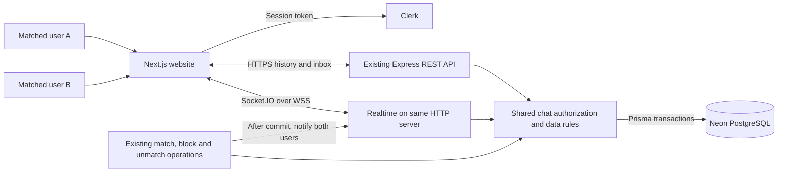
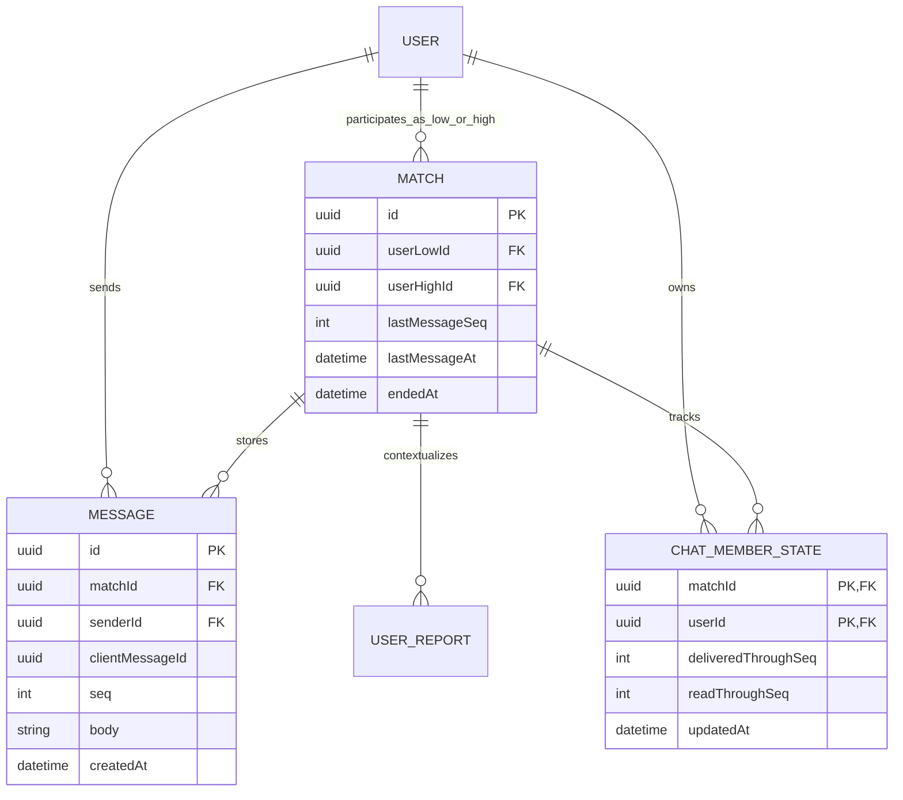
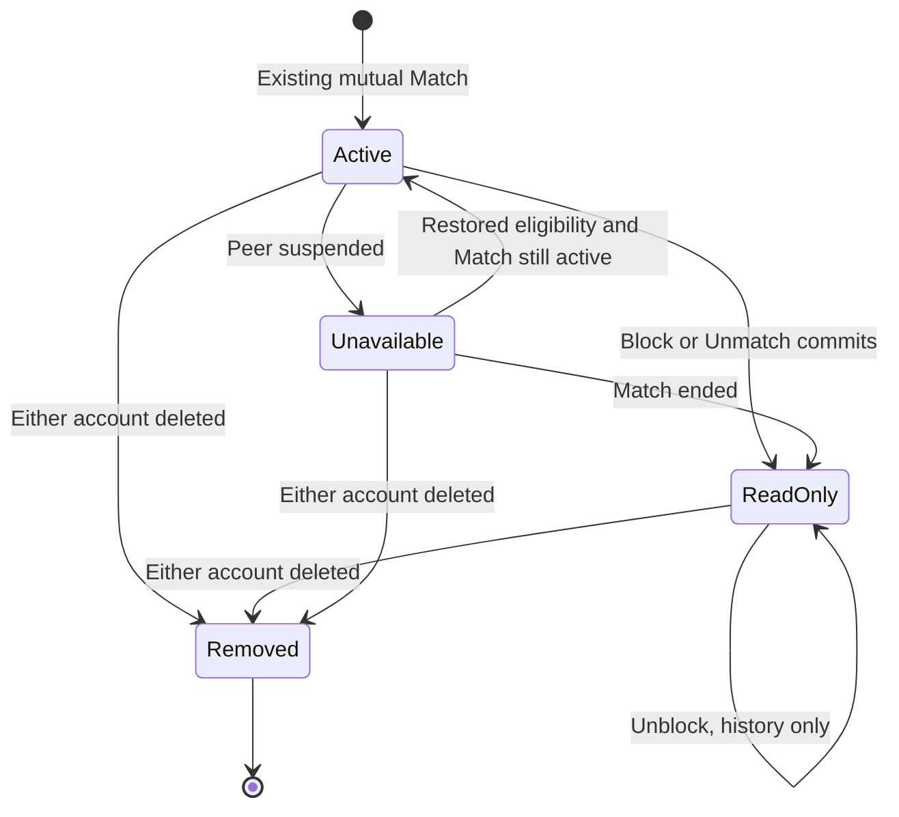

# Messaging — matched-user chat

Status: **implemented (MVP)**. The product decisions below were confirmed through the grill-me interview. Implementation notes and deliberate details:

- Sends, receipts and typing are Socket.IO events with acknowledgements; REST serves the inbox, snapshot, history and unread count. There is no REST send fallback.
- A retry of an already-committed message is answered from the database even when the sender is over a rate limit or the chat has since ended; it never inserts a second row.
- Reports can be filed from a conversation by `matchId` alone (the profile reference is hidden once a chat is not interactive); `messageIds` evidence is rebuilt server-side.
- Message events carry the `matchId`; delivered and read cursors are only ever sent for active conversations.
- Deployment and the remaining manual Clerk webhook setup are in [deployment.md](./deployment.md).

## 1. Agreed release

Two mutually matched users can chat directly on Flatter. Deliver a familiar conversation list, message bubbles, text/emoji composer, saved history, sent/delivered/read indicators, typing, and unread badges. Use the existing Next.js frontend, Express backend, Clerk identity, and Neon PostgreSQL through Prisma.

| Decision | Agreed behavior |
| --- | --- |
| Content | Plain text and Unicode emoji, no attachment or emoji-library dependency. |
| Privacy | HTTPS/WSS and private server-stored messages. This release is **not end-to-end encrypted**. |
| Receipts | Sent, delivered and read, plus typing. No online status or last seen. |
| Message changes | No editing or deletion in this release. Account deletion is a separate lifecycle action. |
| Block/unmatch | Immediately stop accepting new messages. Keep previous messages read-only for both participants. Unblock never restores chat. |
| History retention | Keep active and ended history until account deletion, subject to retention-policy review before public launch. For this plan, deletion of either participant removes the shared conversation and its messages. |
| Reports | Reporter can preview and explicitly submit up to 10 selected messages as evidence. |
| Hosting | One always-running Express server/container initially, supporting persistent WebSocket connections. |

Scope excludes attachments/R2, voice/video, group chat, reactions, message search, browser push/email/SMS notifications, online/last-seen presence, persistent offline sending, and E2EE. Website unread badges work while signed in, with refresh/catch-up when returning.

## 2. Existing foundations and boundaries

- `backend/prisma/schema.prisma`: `Match` already identifies one canonical pair, with terminal end fields. Reuse its ID as the conversation ID. Do not add a separate Conversation table for the same pair.
- `backend/src/matching-data.ts`: reuse `pairLock` and active-block checks. Do **not** reuse discovery's `accountOk` unchanged, since it requires discoverability and a chat must survive discovery opt-out.
- `backend/src/matching.ts`: mutual matching, Block and Unmatch exist. Chat availability currently says coming soon. End actions must notify messaging after the database commits.
- `backend/src/app.ts` and `server.ts`: attach realtime handling to the existing HTTP server and retain health, REST routes, security headers, cleanup and shutdown behavior.
- `frontend/src/components/dashboard/shell.tsx`, `nav.tsx`, `matching/matches.tsx`, `backend/src/profiles.ts`, and shared response types: connect Messages navigation, badges, feature availability and Start chat to real endpoints.
- Reuse the current API/error helpers, Clerk authentication and SafetyDialog patterns. Read `DESIGN.md` and frontend agent instructions before implementation.

**Policy refinement:** this document supersedes the blanket history-read denial in `matching-engine.md` for **Block and Unmatch only**. Separate `canReadHistory` from `canSendMessage`. Implementers must update that document and its final diagram to reflect this distinction. It does not make blocked profiles or listings visible again.

## 3. Architecture

Recommend Socket.IO on the existing Express HTTP server, with WebSocket transport and its polling fallback. This is a realtime library, not a new backend service. Proposed dependencies: `socket.io` in backend and `socket.io-client` in frontend. Use the installed Clerk SDK exports where possible, declaring a direct official backend SDK dependency only if necessary for token verification.

PostgreSQL is the durable source of truth. Socket.IO supplies live events, reconnection and acknowledgements. By default, its delivery is at most once, so database-backed catch-up and idempotent retries are required. See [Socket.IO delivery guarantees](https://socket.io/docs/v4/delivery-guarantees).

Use one authenticated socket per signed-in browser tab in the common app shell. Server-owned rooms are `user:<internalUserId>`, allowing notifications and receipt updates to reach the user's other tabs. Never let clients subscribe to arbitrary user rooms. No general client-controlled conversation-room subscription is needed for two participants.

## 4. Screens and interaction

- `/dashboard/messages`: conversation inbox, including active matches with no messages and ended conversations that contain history. Order conversations with messages by latest server message time, then empty matches by match time, using an ID tie-breaker and bounded pagination.
- `/dashboard/messages/[matchId]`: selected conversation. Matches gets a proper **Start chat** button linking here. A mutual-match prompt may offer the same action only after the feature is available.
- Desktop: inbox column and selected conversation pane. Mobile: inbox screen then full conversation with a Back button. Preserve browser navigation and usable keyboard/virtual-keyboard layouts.
- Header: active peer name/avatar and permitted View profile action, with Report/Block/Unmatch controls. Ended or unavailable peers use neutral identity presentation and no blocked profile link. Do not reveal who blocked whom.
- History: date separators, timestamps, incoming/outgoing neutral bubbles, receipt labels, initial skeleton, older-history loading, empty conversation and retry states. Follow bottom only when already there, otherwise show a New messages button. Loading older history preserves scroll position.
- Composer: labelled multiline text area, Unicode emoji/paste, Send button, Enter to send and Shift+Enter for newline. Do not send during IME composition. A conservative maximum is 2,000 Unicode code points and 16 KiB UTF-8 per message, enforced on server and client. Trim surrounding whitespace and reject whitespace-only content, retaining internal newlines.
- Local states: Sending → Sent → Delivered → Read, or Retry on failure. Never show Sent before database commit. Retry retains the same client message ID. Preserve failed text in memory while the tab remains open. Offline/reconnecting disables fresh sends and leaves drafts editable. Do not persist private drafts in localStorage.
- Ended state: “This conversation has ended. You can still read your messages.” Disable composer, typing and shared receipt updates. Hide unread badges for ended chats. Clear pending sends/typing when closure is observed.
- In-app navigation badge and inbox unread count represent unread **incoming** messages, never the sender's own messages. Opening a background/hidden tab does not mark a thread read.
- Use current `DESIGN.md`: white/soft neutral surfaces, 16px controls/bubbles, current typography, visible focus, meaningful buttons and red reserved for primary actions. No WhatsApp green theme, decorative chat wallpaper or new fonts.
- Keep touch targets at least 44px. Label icon buttons and receipt states, use a restrained live region for incoming messages/status, support reduced motion, and avoid announcing the entire history on each update.

## 5. Planned database additions

This is the schema specification for later Prisma/migration work, not an instruction to migrate while planning. These are application data, not Clerk user/contact duplicates.

| Model | Planned fields and constraints |
| --- | --- |
| Existing `Match` | Add `lastMessageSeq Int @default(0)` and nullable `lastMessageAt` timestamp. Sequence starts at 1 for the first message. Existing pair uniqueness and end fields remain. |
| `Message` → `messages` | `id` UUID PK, `matchId` UUID FK, `senderId` UUID FK, `clientMessageId` UUID, `seq` positive Int, `body` bounded text, server `createdAt` timestamptz. Unique `(matchId, seq)` and `(matchId, senderId, clientMessageId)`. |
| `ChatMemberState` → `chat_member_states` | Composite PK `(matchId, userId)`, FKs, `deliveredThroughSeq Int @default(0)`, `readThroughSeq Int @default(0)`, server `updatedAt`. Missing row means both cursors are 0. Create/update only through explicit receipt writes, never a GET. |
| Existing `UserReport` | Reuse `matchId` and bounded server-generated `snapshot` for selected-message evidence. No new moderation table solely for chat intake. |

Server/migration invariants:

1. A sender/state owner must be one of the Match's two members. Derive sender identity from Clerk, never accept it from payloads.
2. Persist message insertion and the Match counter/time update in one pair-locked transaction. No client timestamp/order is authoritative.
3. Retry with the same idempotency key and same normalized body returns the original message. The same key with changed content is a conflict. A known committed retry may return its original result after closure, but must never insert another message.
4. Receipt cursors never decrease, are nonnegative, satisfy `readThroughSeq <= deliveredThroughSeq <= lastMessageSeq`, and point to an existing sequence or 0. Derive Delivered/Read for outgoing messages from the peer's cursors. Do not create one receipt row per message.
5. Add database checks for same-row bounds and message length, plus transactional membership/cross-row checks. The `(matchId, seq)` index supports history and incoming-unread queries. Add `(senderId)` and `(userId, matchId)` indexes for FK cleanup/member queries as needed. Paginate inbox over existing member indexes first, inspect query plans before adding more.
6. Message/state FKs cascade with their Match, so deleting either account and its Match removes shared chat data. Coordinate deletion with existing listing/photo cleanup, rather than adding an unreviewed top-level account cascade.
7. Existing matches need no per-conversation creation job. Defaults and empty receipt state make them chat-ready. Derive previews from the latest Message, avoid duplicating message bodies in Match.

## 6. Authorization and lifecycle

| Operation/state | Required behavior |
| --- | --- |
| Connect | Valid unexpired Clerk session, allowed Origin/authorized party, existing adult onboarded nonsuspended application user. Server chooses identity and user room. |
| Read inbox/history | Current actor must be an eligible member. Block/unmatch permits old history only, not private profile/listing reads. Nonmember or deleted conversation returns generic not found. |
| Send, typing, shared receipts | Membership, both adult onboarded active accounts, `Match.endedAt = null`, and no active block either direction. Recheck for every event. |
| Discovery disabled, matching unenrolled, intent/budget changed, listing paused/closed | Do not revoke an existing active conversation or re-run compatibility scoring as a chat gate. |
| Block/unmatch | Existing transaction ends Match. After commit notify both user rooms with neutral `conversation:closed`, clear typing, disable sending and freeze shared receipts. Old history remains accessible. |
| Suspension | Suspended actor loses all chat access. Nonsuspended peer can read old history with unavailable state but cannot send. Do not disclose moderation details. Restore permissions only if both accounts become eligible and Match has not ended. |
| Sign-out/session expiry | Disconnect/clear private client state. Server refuses expired credentials, including on previously connected sockets. |
| Either account deleted | Revoke access, disconnect affected sessions, purge shared chat through the coordinated deletion path. Other participant sees conversation unavailable after reconciliation. |

Separate actor eligibility, history permission, and interaction permission in one shared rule used by REST and sockets. Handshake middleware runs once per connection, so it cannot replace event-level authorization. See [Socket.IO middleware](https://socket.io/docs/v4/middlewares).

**Race boundary:** reuse the exact canonical `pairLock` for Send, Block and Unmatch. Check permission inside that transaction. If Send commits first, its message remains part of history even if its network event arrives after closure. If closure commits first, Send cannot insert. Never reopen an ended view because a delayed message event arrived. Protect account-state checks against concurrent suspension/deletion with database row locking in a consistent order, and test those races too. Do not perform remote Clerk/storage/network requests while holding database locks.

Use current Clerk session tokens in Socket.IO's auth payload, never query-string tokens. Verify signature, issuer, expiry and authorized parties using the official SDK. Refresh/re-authenticate before expiry, fail closed at expiry, clear stale timers and disconnect on refresh failure. Normal reconnect must reauthenticate, without skipping authorization through connection-state recovery. The smallest initial design uses database replay instead of Socket.IO state recovery. See [Clerk session tokens](https://clerk.com/docs/guides/sessions/session-tokens) and [verifyToken](https://clerk.com/docs/reference/backend/verify-token).

Local sign-out closes sockets immediately. Remote Clerk session revocation can remain undetected until token expiry unless a verified lifecycle event arrives sooner, so never promise instant remote revocation from JWT signature checks alone. Wire verified, idempotent Clerk account-deletion handling into the coordinated cleanup path before launch. Configure the event signing secret through the deployment secret store, never a committed env file. Webhook retries must be harmless.

## 7. REST and WebSocket contract

All REST chat responses are private/no-store and member-scoped. Use existing error conventions. History default 50 messages, maximum 100, stable sequence-based pagination. Inbox default 30, maximum 50, with an opaque validated ordering cursor. No offset pagination of message history.

| REST | Purpose |
| --- | --- |
| `GET /api/messages` | Paginated inbox, effective active/read-only/unavailable status, latest preview, peer public summary where permitted and unread count. |
| `GET /api/messages/:matchId` | Authorized conversation metadata, current head sequence, both receipt cursors where permitted, latest history page. |
| `GET /api/messages/:matchId/history?beforeSeq=...` | Older pages. |
| `GET /api/messages/:matchId/history?afterSeq=...` | Ascending catch-up pages. `beforeSeq` and `afterSeq` are mutually exclusive. |
| Existing report endpoint | Extend the validated chat context to accept up to 10 selected message IDs, then build evidence server-side. |

| Socket event | Direction and result |
| --- | --- |
| `auth:refresh` | Client → server, verify fresh token for the same user/session, atomically replace expiry, acknowledge or disconnect. |
| `message:send` | Client → server `{matchId, clientMessageId, body}`. Acknowledge only after commit with canonical Message, or a structured error. |
| `message:created` | Server → both participants' user rooms, committed canonical Message. Merge by ID/sequence, never append duplicates. |
| `message:delivered` | Client → server `{matchId, throughSeq}`, persisted monotonic acknowledgement after messages reach a participant's client. |
| `message:read` | Client → server `{matchId, throughSeq}`, persisted monotonic acknowledgement when the selected conversation is visible, focused and brought through that sequence. Reading implies delivery. |
| `receipt:updated` | Server → both user rooms, allowed active-conversation cursor changes. Synchronizes the user's other tabs too. |
| `typing:set` / `typing:changed` | Client → server and server → peer, bounded active boolean with server expiry. Never stored in PostgreSQL. |
| `conversation:closed` / `inbox:changed` | Server → affected user rooms after committed lifecycle/match changes. Clients reconcile authoritative metadata and inbox. Never transmit block author or moderation reason. |

An authenticated socket is not permission to read every match. Never accept client sender/recipient IDs, rooms, receipt owners, timestamps or closure status. Every client event has a strict schema, bounded payload and an acknowledgement or explicit error. Expected error codes include `UNAUTHENTICATED`, `NOT_FOUND`, `CONVERSATION_CLOSED`, `VALIDATION_ERROR`, `IDEMPOTENCY_CONFLICT`, `RATE_LIMITED`, and `UNAVAILABLE`. Retry transport/service failures with the same ID, not permission or validation failures.

Delivered means at least one recipient client acknowledged receipt, **not** that the socket exists or the server emitted a packet. Read is a client-reported UI acknowledgement, not proof a person understood the content. Opening a visible conversation at its latest message marks that sequence and earlier messages read. Never mark read solely from a notification/inbox preview. Cursors are account-wide across tabs/devices. Ended conversations do not update or broadcast cursors.

Typing is transient: send at most once every two seconds while composing, expire after five seconds without renewal, stop on send/blur/navigation/closure. Do not expose typing unless the conversation is currently interactive. Disconnect or process restart naturally clears it.

## 8. Delivery, ordering and reconnect

1. Create a client UUID for one send attempt and render Sending. Validate authenticated actor/payload on the server.
2. In a transaction, acquire pair lock, check membership/idempotency and current interaction permission, increment Match sequence, insert Message and update timestamp. Commit before success acknowledgement or content emission.
3. Acknowledge canonical message and emit to both users' authenticated rooms. A timeout is uncertain delivery, so retry the same ID with a bounded retry policy and then show Retry. Never produce duplicate database rows.
4. Merge client messages by server ID and sequence, reconciling the optimistic item through `clientMessageId`. Order by `seq`, not arrival time or client clock. Queue per-conversation local sends so repeated retries cannot overtake a user's preceding pending send.
5. On reconnect, focus return, detected sequence gap and periodic reconciliation while visible, fetch inbox and catch up after the **last contiguous** local sequence. Page until caught up. Never advance that cursor across a gap. A new tab starts with latest history and loads older pages on demand, rather than replaying the account's entire lifetime.
6. Establish/authenticate the socket before initial HTTP snapshot, buffer live events during hydration, then merge snapshot and events by sequence. Once caught up, acknowledge delivery and read only under the UI rules. Catch-up for a closed chat is read-only and emits no receipts.
7. Server crash after commit but before emit is repaired by catch-up. A low-frequency visible-tab reconciliation, such as every 30 seconds, covers missed closure/match/content notifications even if another socket remains connected. On API/DB failure show stale/reconnecting status and retain draft text, never fabricate a successful send.

This provides durable storage and an effectively-once displayed message through idempotency, **not exactly-once network delivery**. No Redis, message broker or outbox is required for the initial single-server website with database reconciliation. A process restart loses transient typing only. Pending in-memory unsent text may be lost on refresh, which must not be presented as a durable offline queue.

## 9. Safety, retention and operational limits

- Render messages as plain text, never HTML. Do not fetch link previews. Reject invalid IDs/cursors, excessive content/payloads and unexpected fields. Chat bodies, tokens and report excerpts must not appear in application logs, analytics or error-monitoring breadcrumbs.
- Enforce explicit configured browser Origin at the WebSocket handshake as well as HTTP CORS for polling. Enforce token authorization independently, since Origin is not identity. Limit socket count per user, and account-scope socket event rates because the existing Express limiter does not cover WebSocket events.
- Initial tunable caps: five simultaneous sockets/user, 30 new messages/minute/user and 10/10 seconds/conversation, plus bounded receipt/typing/auth-refresh traffic. Failed validation is limited too. Idempotent retries return an existing result without consuming a new-message allowance. Use protocol packet limits compatible with the text caps, not unbounded defaults.
- Report flow: select at most 10 visible conversation messages → preview excerpts and written reason/details → confirm. Server checks reporter membership and message ownership by conversation, derives sender/time/body from stored rows, and stores only selected excerpts in `UserReport.snapshot`. Never trust submitted excerpts or disclose the report to the target. Reuse reason choices and review workflow from `report-review.md`, with separate Report only / Report and block options.
- Until a retention exception is explicitly approved, report rows/evidence follow existing deletion cascades too. Do not claim abuse evidence survives account deletion. Review `report-review.md`'s proposed retention and deletion gap before public launch, document the final policy, and tell users how account deletion affects the other person's history.
- Retention review must also cover database backups and any service logs. Account deletion removes live application access/data through the deletion path, not an assertion that every provider backup is erased synchronously. Restrict operational database/message access to staff who need it, and disclose that this is server-readable chat.
- Use TLS, provider storage protections, production secrets and least-privilege deployment configuration. No R2 setup is needed for text chat.
- The reverse proxy/container must forward WebSocket upgrades, permit polling when enabled, and set idle timeout above heartbeat interval plus timeout. Add graceful socket drain/disconnect on shutdown. Keep `/health` independent of Clerk/DB. See [Socket.IO reverse proxy](https://socket.io/docs/v4/reverse-proxy).
- One instance is an explicit launch limit. Before multiple replicas, add a shared Socket.IO adapter and shared rate-limit/revocation coordination. Polling across replicas also needs sticky sessions. See [multiple nodes](https://socket.io/docs/v4/using-multiple-nodes). Do not silently scale containers while rooms and limits are in memory.
- Active chat/receipts/reconciliation create database work and may keep Neon compute awake. Batch cursors, avoid per-message Clerk network calls, stop reconciliation in hidden tabs and measure usage before scaling. No extra Neon branch or paid infrastructure is required just to write this plan.

## 10. Implementation blocks and verification

| Block | Concrete work and completion check |
| --- | --- |
| 1. Persistence and permissions | Extend Prisma/relations and migration constraints, implement shared history/interaction authorization, sequence/idempotency and cursor writes. Add focused backend tests for membership, bounds, deduplication and transaction failures. |
| 2. History and inbox | Add authenticated REST endpoints and bounded cursors, empty existing-match support, previews/unread logic and ended-history access. Test nonmember UUID guessing and no-store behavior. |
| 3. Realtime lifecycle | Attach Socket.IO to existing server, Clerk auth/refresh/expiry, room scoping, event validation/rates, shutdown and commit-first send/receipt/typing. Integrate match/block/unmatch and account lifecycle notifications without breaking existing HTTP routes. |
| 4. Website | Build responsive inbox/conversation routes and one client socket owner in app shell. Wire Matches Start chat, Messages nav/feature response, unread badge, safety controls and loading/failure states. Reuse design tokens/helpers. |
| 5. Safety and documentation | Add selected-message report evidence with explicit confirmation, coordinate verified account deletion/cleanup, update `databse.md`, matching-engine chat/history policy and numbered final diagram, report-review procedure and env/deployment docs. Do not change unrelated feature plans. |
| 6. Verification and rollout | Run focused tests, existing backend suite, frontend lint/build and required typechecks. Exercise two real accounts and multiple tabs through the acceptance cases below. Enable feature availability only when real routes and gates work. |

Required acceptance cases:

1. Mutual match enables an empty chat, a single Like/nonmember cannot chat, existing matched accounts need no new onboarding. Discovery opt-out and listing closure do not terminate a conversation.
2. Two browsers exchange Unicode/emoji/newlines, see correct Sent/Delivered/Read, and receive typing that expires. Background tab does not mark read. Unread count excludes own messages and reconciles across tabs.
3. Recipient offline, dropped acknowledgement, duplicate send, delayed/out-of-order events and server restart produce one stored message and ordered recoverable history. Crash between commit and emit is recovered by reconciliation.
4. Retry a failed optimistic message using the same client UUID, change the body under a reused UUID, and send oversized/blank/malformed payloads. Confirm conflict/validation behavior without data loss or XSS.
5. Race Send against Block/Unmatch in both commit orders. No message is inserted after closure, delayed old events cannot reopen the composer, history remains read-only, and unblock cannot restore sending.
6. Expired token, failed refresh, forged user/room IDs, third-party Origin, account suspension and deletion all fail closed. Verify existing sockets cannot bypass state changes and unaffected peer history behavior follows the policy.
7. Pagination during new arrivals has no duplicates/skipped sequence, upward history loading preserves scroll, and reconnect catches every page of a gap. Rapid tab switching cleans listeners and typing timers.
8. Report selected excerpts only after confirmation, reject messages from another chat, keep report private and exercise account-deletion cascades. Check logs contain no message content or tokens.

Do not push database changes into an arbitrary Neon branch. At implementation time inspect the configured development target, use the project's migration workflow, and report the exact target and migration status. Production migration/deployment is a separate release action. No new branch is required by the design.

## 11. Full numbered feature sequence

Read top to bottom. `A` and `B` are matched users, `UI A/B` their website tabs. All durable state is in PostgreSQL, and live events supplement authorized reads.

```mermaid
sequenceDiagram
    autonumber
    actor A as User A
    participant UA as Website A
    participant Clerk
    participant API as Express REST
    participant WS as Express Socket.IO
    participant DB as Neon PostgreSQL
    participant UB as Website B
    actor B as User B
    A->>UA: Complete onboarding and Like B
    B->>UB: Complete onboarding and Like A
    UB->>API: Existing reciprocal Like
    API->>DB: Pair lock, validate and create unique Match
    DB-->>API: Commit mutual Match
    API-->>UB: Match with real Start chat route
    A->>UA: Open Messages or Start chat
    UA->>Clerk: Get current session token
    Clerk-->>UA: Short-lived signed token
    UA->>WS: Connect with auth payload
    WS->>WS: Validate Origin, JWT, expiry and actor eligibility
    WS->>DB: Resolve application identity
    WS-->>UA: Join server-owned user room, authenticated
    UA->>API: Fetch inbox and selected Match history
    API->>DB: Verify membership and history permission
    DB-->>API: Messages, head sequence, cursors and effective state
    API-->>UA: Private no-store snapshot
    UA->>UA: Merge buffered live events, render ordered history
    B->>UB: Open website and chat
    UB->>Clerk: Get session token
    UB->>WS: Authenticate and join own user room
    UB->>API: Load permitted conversation snapshot
    API-->>UB: Current history and metadata
    A->>UA: Compose text or emoji
    UA->>WS: typing:set with Match ID
    WS->>DB: Check current interaction permission
    WS-->>UB: Typing, expires without renewal
    A->>UA: Press Send
    UA->>UA: Create client UUID and render Sending
    UA->>WS: message:send with Match ID, UUID and body
    WS->>WS: Validate payload, token and rate limits
    WS->>DB: Begin transaction, pair lock and account-state locks
    DB->>DB: Verify membership and current gates, check idempotency
    alt Conversation active and request is new
        DB->>DB: Increment sequence, insert Message and update Match time
        DB-->>WS: Commit canonical Message
        WS-->>UA: Success acknowledgement, mark Sent
        WS-->>UA: message:created to sender tabs
        WS-->>UB: message:created to recipient tabs
    else Retry of same committed content
        DB-->>WS: Return original Message, no insert
        WS-->>UA: Canonical acknowledgement, deduplicate
    else Closed, unauthorized, invalid or conflicting request
        DB-->>WS: No insert
        WS-->>UA: Structured error, retain text where appropriate
    end
    UB->>UB: Merge Message by ID and sequence
    UB->>WS: message:delivered through received sequence
    WS->>DB: Recheck permission, advance own delivery cursor
    DB-->>WS: Commit
    WS-->>UA: receipt:updated, mark Delivered
    opt B views active focused chat through latest message
        UB->>WS: message:read through visible sequence
        WS->>DB: Validate and advance read and delivery cursors
        DB-->>WS: Commit
        WS-->>UA: receipt:updated, mark Read
        WS-->>UB: Sync other tabs and unread badge
    end
    opt Connection drops, event is missed or server restarts
        UA->>Clerk: Obtain fresh token
        UA->>WS: Reconnect and reauthenticate
        UA->>API: Reconcile inbox, fetch after last contiguous sequence
        API->>DB: Authorize and load bounded ascending pages
        DB-->>API: Committed missed Messages and current state
        API-->>UA: Catch-up pages and cursor metadata
        UA->>UA: Deduplicate, fill gaps and restore ordered view
        Note over UA,API: Also reconcile on focus and visible-tab timer
    end
    opt Session approaches expiry
        UA->>Clerk: Refresh session token
        UA->>WS: auth:refresh with fresh token
        WS-->>UA: Revalidate same session or disconnect at expiry
    end
    opt A reports abuse
        A->>UA: Select up to 10 Messages, preview and confirm
        UA->>API: Report with selected Message IDs
        API->>DB: Validate membership and load only selected evidence
        DB-->>API: Save private report snapshot
        API-->>UA: Report received, target not notified
    end
    opt Either user blocks or unmatches
        UA->>API: Existing Block or Unmatch action
        API->>DB: Same pair lock, end Match and commit
        API-->>WS: Notify committed closure
        WS-->>UA: Neutral conversation:closed
        WS-->>UB: Neutral conversation:closed
        UA->>UA: Disable send and typing, freeze shared receipts
        UB->>UB: Same read-only state, no blocker identity disclosure
        UA->>API: Read previous history
        API->>DB: Allow eligible member read without interaction permission
        API-->>UA: Previous Messages, read-only
        UA->>WS: Stale or malicious new send
        WS->>DB: Check gate under pair lock
        DB-->>WS: Closed, no Message inserted
        WS-->>UA: CONVERSATION_CLOSED
    end
    opt Either account is deleted
        Clerk->>API: Verified account-deletion lifecycle event
        API->>DB: Coordinated idempotent cleanup, remove Match chat data
        DB-->>API: Commit deletion
        API-->>WS: Revoke affected access and invalidate inbox
        WS-->>UA: Disconnect deleted actor or reconcile unavailable chat
        WS-->>UB: Reconcile unavailable chat, no remaining live history
    end
```

