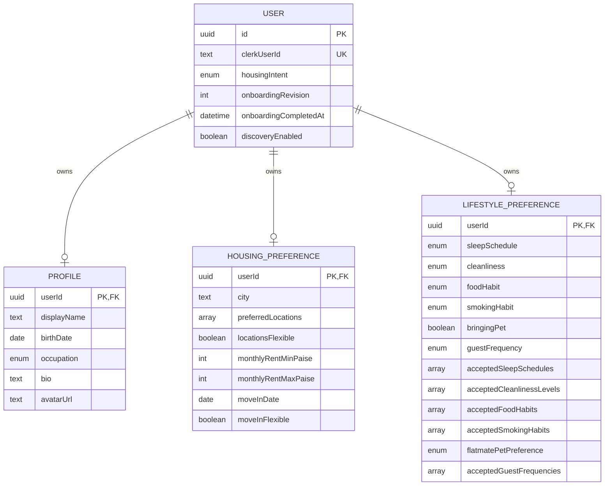
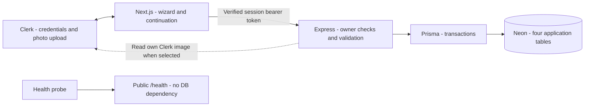

# Flatter onboarding plan

Status: proposed implementation plan and Prisma schema, prepared 9 November 2026. No onboarding UI/API, database connection, client generation, or migration is implemented by this task.

Schema source: [`backend/prisma/schema.prisma`](../backend/prisma/schema.prisma). All four models live in this one file under the backend because Express owns application data. Do not create a second schema in the frontend or repository root. The existing [database document](./databse.md) is updated to point here.

## 1. Decisions from the grill-me interview

| Question | Confirmed decision |
| --- | --- |
| Existing flat: full listing during onboarding? | Profile and city/locality now. Room listing afterward. |
| Habits versus flatmate expectations? | Collect both separately. A non-smoker can still accept a smoker, for example. |
| Eligibility? | Adults aged 18+ only. |
| Photo? | Optional; Google/Clerk avatar or Clerk upload, with initials fallback. |
| Rent and timing? | Required per-person monthly rent range in INR and move-in/available-from date, with an explicit Flexible option. |

Other proposed MVP choices: one housing intent at a time, one city, up to five preferred locations, optional bio, no compatibility score yet, and an explicit discovery opt-in on review. These are recommendations rather than additional interview answers.

## 2. Existing code and what must change

- Clerk is already configured in both applications. Google and email authentication must converge on the same onboarding flow; do not create separate flows per login provider.
- `frontend/src/components/auth-controls.tsx` currently sends all successful login/signup actions to `/route`. Change those destinations to `/auth/continue`, which checks backend onboarding state.
- `frontend/src/proxy.ts` initializes Clerk but does not protect onboarding/product routes. Add authentication protection for those routes, while keeping the landing page, static assets, Clerk callbacks, and health probe accessible.
- `GET /api/me` currently returns only the verified Clerk ID. Preserve that contract. Add separate onboarding endpoints instead of silently changing this response.
- No Prisma dependency, generated client, database configuration or onboarding UI exists. The schema added with this plan is a proposal, not a deployed database.
- Follow `DESIGN.md`: textured electric blue, cream surfaces, deep-indigo controls, existing Inter/Geist Mono fallback hierarchy, generous spacing, and existing original logo. This plan does not replace the design system.

## 3. Entry, resume and exit behavior

1. After any successful Clerk login/signup, go to `/auth/continue`.
2. Require an authenticated Clerk session. Next.js obtains a session token server-side and calls Express; Express verifies it independently. No database call from `proxy.ts` and no unverified browser-provided user ID.
3. Read onboarding state from the application database:
   - No user row: start at Intent. Do not create a row in a GET request.
   - Draft: resume at the earliest incomplete/invalid step.
   - Complete: skip questions and go to `/route` for this slice. A real discovery destination replaces this only when that product route exists.
   - Database/API unavailable: show retry and sign-out; do not treat an outage as an empty profile or completed onboarding.
4. Onboarding uses `/onboarding?step=intent|about|housing|lifestyle|flatmate|review`. The query parameter is navigation only. The backend decides which steps are valid; a URL cannot bypass missing answers.
5. Save each step on Continue, then advance only after success. Back preserves the saved draft. Refresh loads the draft. Unsaved edits remain in memory with a leave-page prompt; do not store DOB or the full form in localStorage.
6. Final success requires a database commit. Clear local form state and return to `/route` with a completed state, not a made-up match result.

Onboarding is required once, not on every login. An existing incomplete account resumes; a completed account is never reset merely because the login provider changes. A newly authenticated user can still read the public landing page. Future discovery/chat/listing APIs must enforce completion themselves.

## 4. Screens and questions

Use a six-step progress indicator, one clear heading per step, Back and Continue controls, field-level validation, and a persistent sign-out option. Do not build a generic form-builder system.

### Step 1 — What are you looking for?

Heading: **What are you looking for?**

Supporting text: **We'll personalize your experience based on what you need.**

| Choice | Description | Stored value |
| --- | --- | --- |
| I have a flat, need a flatmate | Find someone to move into your existing place. | `HAVE_ROOM` |
| Find a flat together | Meet compatible people and rent a new place together. | `TEAM_UP` |
| I need a room | Discover available rooms in shared apartments. | `NEED_ROOM` |

Use accessible radio cards, no default selection. Continue requires exactly one choice. This save creates/upserts the application `User` from the verified Clerk identity.

Changing intent during a draft retains personal and lifestyle answers. Clear/revalidate intent-specific housing data, explain the changed labels, and make the user confirm the housing step again. No room listing is created.

### Step 2 — About you

Heading: **Tell us about yourself.**

| Question/control | Required? | Rules and storage |
| --- | --- | --- |
| What should we call you? | Yes | `Profile.displayName`; trim, 1–80 characters. Suggest Clerk's name but allow editing. Do not demand a legal name. |
| Date of birth | Yes | `Profile.birthDate`, a date-only value. Derive age; do not store an age that goes stale. 18+ eligibility is enforced server-side. |
| What do you do? | Yes | `Profile.occupation`: Student, Working professional, Self-employed, Other. |
| A little about you | No | `Profile.bio`; max 500 characters, whitespace-only becomes null. Render as plain text. |
| Profile photo | No | `Profile.avatarUrl`; prefill a real Google/Clerk photo, allow Clerk upload/remove, otherwise initials. |

Date of birth is private; future public cards receive derived age only. Compute eligibility using calendar dates in Asia/Kolkata, not elapsed milliseconds or UTC offsets. Reject invalid/future dates; use a documented conservative 1 March anniversary for 29 February birthdays in non-leap years. Under-18 submissions show an eligibility message and cannot continue or complete; do not persist their rejected DOB into the profile. This is a product eligibility rule, not a claim of identity/age verification.

Photo handling: use Clerk's `setProfileImage` upload support, not another storage dependency. In the proposed app API, the client asks to use its current Clerk image or clear the Flatter image; the backend derives the URL from that authenticated Clerk account. Do not accept an arbitrary avatar URL or fetch a user-submitted URL. Check file type/size against supported Clerk limits when implementing, surface upload failures, and allow completion without a photo. Photo updates affect the Clerk account image; explain that in the UI. Save the selected URL as a Flatter snapshot. Changes made later outside onboarding do not automatically synchronize; profile settings will explicitly refresh/clear it.

### Step 3 — Housing preferences

Heading: **Where would you like to live?** For `HAVE_ROOM`: **Tell us where your flat is.**

| Field | Required? | Rules |
| --- | --- | --- |
| City | Yes | One supported city. Store a canonical city value from a small curated launch list, not arbitrary spelling variants. Launch cities must be selected before building this control. |
| Preferred locations | Yes, or explicit flexibility | For `NEED_ROOM`/`TEAM_UP`, choose 1–5 localities within the city, or “Anywhere in this city.” Deduplicate and validate against that city's curated list. No maps API required. |
| Flat locality | Yes for `HAVE_ROOM` | Reuse `preferredLocations` with exactly one value and `locationsFlexible = false`; label it as current flat locality. No street address or precise coordinates collected. |
| Monthly rent per person | Yes | INR minimum and maximum; exclude deposit, utilities and brokerage and say so. Persist integer paise, never floating-point money. |
| Move-in date / Flexible | Yes | For `NEED_ROOM`/`TEAM_UP`, earliest desired move-in. For `HAVE_ROOM`, available-from date. Date-only, today or later when saved/completed; Flexible means no date. |

Rent semantics: seekers provide their budget range. `HAVE_ROOM` provides the expected monthly rent for the incoming flatmate, stored with minimum equal to maximum. Onboarding does not verify this amount or publish a room listing.

Fields: `city`, `preferredLocations`, `locationsFlexible`, `monthlyRentMinPaise`, `monthlyRentMaxPaise`, `moveInDate`, `moveInFlexible`. City changes clear old localities. Flexible location/date are explicit answers, not inferred from an untouched empty field. Confirm stale past move-in dates when resuming a draft. Limit paise amounts to positive signed-32-bit integers; minimum must not exceed maximum. The client converts rupees/paise exactly and the server validates the integer inputs.

### Step 4 — Your lifestyle

Heading: **What is living with you like?** Supporting copy explains that honest answers help find compatible people, not that one habit is better.

| Question | Field | Choices |
| --- | --- | --- |
| When are you usually awake? | `sleepSchedule` | Early bird / Night owl / Flexible |
| How tidy do you keep shared spaces? | `cleanliness` | Relaxed / Regular / Very tidy |
| What is your food preference? | `foodHabit` | Vegan / Vegetarian / Eggetarian / Non-vegetarian |
| Do you smoke? | `smokingHabit` | Non-smoker / Only outdoors / Indoors too |
| Will you bring a pet? | `bringingPet` | Yes / No |
| How often do you host guests? | `guestFrequency` | Rarely / Occasionally / Frequently |

Each question is required with no preselected answer. Define helper text consistently: cleanliness describes shared spaces; food describes the diet the person follows; smoking includes cigarettes/vaping; guest frequency describes expected home visits (Rarely: about monthly or less, Occasionally: about weekly, Frequently: several times a week). Overnight guests are not a separate preference in this MVP. Use the same descriptions when choosing acceptable flatmate habits.

### Step 5 — Your flatmate preferences

Heading: **What works for you in a flatmate?** Supporting text: **Your preferences can be different from your own habits.**

Collect accepted sleep schedules, cleanliness levels, food habits, smoking habits, and guest frequencies as multi-selects. For each, allow an explicit “Any of these is fine,” which expands to all currently supported enum values. At least one accepted value per category is required. Empty means unanswered, not “anything.” Deduplicate choices. Do not prefill answers based on the user's own habits.

For pets, ask **Are you comfortable living with someone who brings a pet?** Choose Okay with pets / No pets / No preference. This is separate from whether the user brings a pet. It concerns the flatmate bringing pets; “No pets” does not imply the user has no pet.

Food acceptance describes comfort sharing a kitchen/home with those dietary habits; it is not an allergy or religious inference. Do not silently turn a personal vegetarian answer into a ban on non-vegetarian flatmates. No caste, religion, or inferred sensitive-trait filtering.

Keep the self answers and accepted answers in separate named columns of `LifestylePreference`, not a JSON blob, duplicate user flags, or a separate table for every question.

### Step 6 — Review and finish

Heading: **Ready to find your people?**

- Summarize intent, personal profile, housing, own habits, and accepted flatmate habits with Edit links to each step. Show age, not full DOB, in the summary; keep DOB editable only in About you.
- Show the selected photo or initials. Clearly distinguish a draft profile from verified identity or a published room listing.
- Include an unchecked-by-default **Make my completed profile visible to other signed-in Flatter users** toggle. This controls future discovery, not whether onboarding can finish. No marketing consent bundled into it.
- Finish revalidates all persisted answers on the server, checks the submitted revision, and atomically sets `onboardingCompletedAt` plus the chosen `discoveryEnabled`. The browser never sets completion timestamps.
- Disable duplicate submission while pending, preserve answers on error, and show targeted Edit links for stale/invalid sections. Never show success before the commit.

## 5. Models and ownership

### User — identity, intent, onboarding state

| Fields | Purpose |
| --- | --- |
| `id` (UUID PK), `clerkUserId` (unique text) | Stable application identity and external Clerk link; never join by email. |
| `housingIntent` (nullable enum in drafts) | The three choices from Step 1. |
| `onboardingRevision` (integer, starts at 0) | Increment on every onboarding write; prevents silent overwrites from multiple tabs. |
| `onboardingCompletedAt` (nullable UTC timestamp) | Server-owned completion marker. |
| `discoveryEnabled` (boolean, false) | Explicit user visibility choice; completion is an additional required condition. |
| `createdAt`, `updatedAt` | Application record timestamps. |

Remove the previous proposed `User.displayName`/`avatarUrl`; those now live exclusively in `Profile`. No database has been created, so this is a design revision rather than a data migration. If any tables have been applied outside this workspace, inspect them first and migrate values before dropping old columns.

### Profile — personal information

`userId` is both UUID primary key and FK to `User.id`. Columns: `displayName`, `birthDate`, `occupation`, `bio`, `avatarUrl`, `createdAt`, `updatedAt`.

### HousingPreference — one current housing search context

`userId` is both PK and FK. Columns: `city`, `preferredLocations`, `locationsFlexible`, `monthlyRentMinPaise`, `monthlyRentMaxPaise`, `moveInDate`, `moveInFlexible`, `createdAt`, `updatedAt`. Single city and INR only for this MVP. A future property listing is a separate entity.

### LifestylePreference — habits plus accepted flatmate habits

`userId` is both PK and FK. Own habits: `sleepSchedule`, `cleanliness`, `foodHabit`, `smokingHabit`, `bringingPet`, `guestFrequency`. Accepted habits: `acceptedSleepSchedules`, `acceptedCleanlinessLevels`, `acceptedFoodHabits`, `acceptedSmokingHabits`, `flatmatePetPreference`, `acceptedGuestFrequencies`. Also `createdAt`, `updatedAt`.

Each dependent row is optional until its step is saved, and each user has at most one of each. Each FK uses `onDelete: Cascade` for these user-owned records. Primary/unique keys already index owner lookups; add no speculative matching/search indexes.

### Nullable drafts and constraints

Required-at-finish fields remain nullable in the schema to support incomplete drafts. Arrays default to empty; nullable booleans distinguish “not answered” from false. Absence of an entire dependent row also means incomplete. Do not add a separate `onboardingStep`, duplicate completion boolean, or onboarding-answer history table; derive progress from validation.

The Prisma schema enforces enum values, foreign keys, uniqueness, types, and string column limits. It does **not** by itself enforce age, valid enum-array cardinality, date flexibility, rent relationships, or completeness across tables. The implementation must provide server validators plus migration CHECK constraints for local invariants:

- nonnegative revision; completed user requires housing intent; discovery cannot be enabled on an incomplete user;
- positive integer rents and minimum ≤ maximum when both supplied;
- true date flexibility requires null date; false requires a date;
- true locality flexibility requires an empty location list; false requires 1–5 entries;
- trimmed nonempty supplied name/city, supplied bio length, and no duplicates in submitted arrays at the API boundary.

Age and “date is today or later” are time-dependent checks at save/finish, not permanent database CHECKs. Cross-table completion is enforced in the backend's single controlled write transaction. No claim that nullable Prisma fields guarantee complete profiles. Database credentials must be restricted to the backend/migration tooling.

## 6. Draft persistence and API contracts

All `/api/onboarding` endpoints require verified Clerk session bearer tokens, use owner-scoped lookups, send `Cache-Control: no-store`, accept JSON with bounded payload size, and allow only the documented fields. Clerk authentication must precede any user-data read/write.

| Method / path | Behavior |
| --- | --- |
| `GET /api/onboarding` | Return caller's saved draft, revision, completion state, per-step validity and next step. Missing row returns empty state with revision 0. Never writes. |
| `PATCH /api/onboarding/intent` | `{ revision, housingIntent }`; first valid intent save creates the user. Subsequent saves update intent with the concurrency rules below. |
| `PATCH /api/onboarding/profile` | `{ revision, displayName, birthDate, occupation, bio, photoAction }`; photo action is Keep / Use current Clerk image / Clear. No arbitrary URL, owner ID, timestamps, or completion flags. |
| `PATCH /api/onboarding/housing` | `{ revision, ...housing fields }`; validates city/localities, rent semantics and date options. |
| `PATCH /api/onboarding/lifestyle` | `{ revision, ...six own-habit fields }`; only self answers. |
| `PATCH /api/onboarding/flatmate` | `{ revision, ...accepted-habit fields }`; only flatmate expectations. |
| `POST /api/onboarding/complete` | `{ revision, discoveryEnabled }`; re-read and validate all saved data, then commit completion/visibility. Does not accept an entire unvalidated form or a browser-created timestamp. |

PATCH saves a validated section, not arbitrary partial field mutations. Return `{ revision, nextStep, stepValidity, onboardingCompletedAt }` and the authoritative saved section as needed. `birthDate`/date values use `YYYY-MM-DD` JSON strings; currency uses integer paise; enums use the schema values. `GET` is owner-only and is never the public profile response.

Error contract: `401 UNAUTHENTICATED`; `403 AGE_RESTRICTED` for rejected age; `409 REVISION_CONFLICT` or `ONBOARDING_ALREADY_COMPLETE`; `422 VALIDATION_ERROR` with section/field messages; `503 TEMPORARILY_UNAVAILABLE` for DB/service outages without exposing internals. Use a small consistent `{ error: { code, message, fields? } }` envelope for the new endpoints; preserve existing `/api/me` behavior.

### Concurrency and finalization

- After initial user creation, every step mutation checks the supplied revision and acquires the parent user's write lock by conditionally incrementing that revision as the **first database write** in the transaction. Then write the dependent section and commit. Rollback restores everything on failure. Every onboarding writer follows the same parent-first ordering.
- First intent save uses the unique Clerk ID to tolerate simultaneous creation. A losing concurrent request reads the existing state and returns conflict instead of overwriting it.
- Finish uses the same parent-first revision check/lock, reads all dependent rows, revalidates intent-specific rules, and sets the timestamp/visibility in that transaction. No network call or image upload inside a DB transaction.
- Stale writers receive 409 and keep unsaved local input for review; they must fetch fresh state before retrying. Do not auto-merge conflicting form answers. Bound retries for database deadlocks/write conflicts; do not retry validation failures.
- Retried Finish after a successful-but-lost response returns the existing completion result without altering timestamp/visibility. Other writes to completed onboarding return conflict; subsequent profile editing belongs to authenticated profile settings, outside this slice.
- If a user deletes their Clerk identity, application cleanup removes the user and cascades these three child rows. Verify deletion webhooks and handle duplicates; do not recreate a deleted user from a late creation webhook. Signup/onboarding does not wait for webhooks.

## 7. Compatibility meaning and privacy

Collect structured answers now, but do not invent a match percentage. A later compatibility design must compare A's habits against B's accepted values **and** B's habits against A's accepted values, plus compatible intent/city/rent/timing. For pets, compare the person's `bringingPet` to the other person's `flatmatePetPreference`. Explicit No preference accepts both. Neither user has to share identical habits.

`HAVE_ROOM` ↔ `NEED_ROOM` and `TEAM_UP` ↔ `TEAM_UP` are the initial intent relationships; they are not automatic matches or proof of availability. Hard filters versus soft ranking and their weights require a separate decision before discovery ships. Multi-value acceptance is data collection, not a promise that every mismatch is a deal-breaker.

Keep DOB, Clerk IDs, raw owner IDs, and onboarding internals private. Public profile responses must be separately allowlisted. City and locality may be displayed only under the agreed visibility rules; do not collect exact addresses here. A discoverable profile requires an active eligible account, valid completion, and `discoveryEnabled = true`; toggling it false must remove future discovery visibility. Neither onboarding nor a Google login is a verified-room/verified-person badge.

## 8. UI blocks, states and accessibility

Build an `OnboardingShell` with the existing Flatter logo, progress, sign-out, form content and navigation; six focused sections; review summaries with Edit links; and shared field/error controls only where truly reused. Use native labelled form inputs, fieldsets/legends, radio groups and checkboxes. A matching percentage, chat preview, property card, tutorial carousel or animation library is unnecessary.

Cream form canvas with textured blue brand header/sidebar; retain the design palette and 0.75rem button corners. On narrow viewports use a single column, readable step label, stacked controls, and no horizontal scrolling. Do not copy the marketing page's 6rem gaps inside every form field.

Handle initial loading, empty draft, saving, saved, upload pending/error, validation errors, revision conflict, session expiry, offline/network errors, API outage, ineligible age, completion pending, and completion success. Keep inputs after recoverable failures. Session expiry prompts login then reloads the saved draft. Do not queue unsupervised background writes or claim offline save.

Keyboard-operable cards and back/edit controls; visible focus; text errors tied with `aria-describedby`; focus error summary/first invalid field on failure; announce save/error state; move focus to each step heading after successful navigation. Test 360px, tablet, desktop, 200% zoom, color contrast and reduced motion.

## 9. Implementation blocks and order

1. **Database foundation:** pin a compatible Prisma 7 release (schema targets 7.10.1), check Node/package engine compatibility, add backend Prisma CLI/client and the PostgreSQL driver adapter needed by that version. Configure `backend/prisma.config.ts` with explicit dotenv loading and server-only Neon URLs. For Prisma 7 the URL is not in `schema.prisma`. Create the generated client in the schema's declared output and exclude generated output from source control as appropriate. No frontend database dependency.
2. **Migration:** inspect whether any remote tables exist before applying; generate and review the four tables, enums, unique/FK constraints and additional CHECKs described above. Use an isolated development Neon branch first. Do not use destructive reset/db-push shortcuts against an existing environment. Separate migration and pooled runtime connection needs according to the selected Neon/driver setup.
3. **Backend:** shared owner authentication, step validators and completeness derivation, Prisma access, the seven onboarding routes, consistent errors and concurrency-safe transactions. Update lifecycle/deletion handling before live personal data. Keep `/health` independent of the database.
4. **Post-auth routing:** update all three current auth controls, add `/auth/continue`, protect `/onboarding`, preserve public routes, use DB-backed continuation/completion checks. Session-dependent Next.js reads remain under Suspense because Cache Components are enabled. No duplicated completion authority in Clerk metadata.
5. **Frontend wizard:** saved-draft loading, six sections, intent-aware housing labels, optional Clerk image flow, back/edit/resume, validated saves, review and Finish. Add a small authenticated backend caller, not another state-management framework.
6. **Verification and setup docs:** validate/generate schema, test backend invariants, check production build/lint/types, manually exercise actual Google/email sessions and all three intents. Document local setup and development data cleanup.

Future file scope: `backend/package.json`/lockfile, `backend/prisma.config.ts`, `backend/prisma/schema.prisma`, reviewed migrations, backend database/validation/onboarding route modules, `backend/src/app.ts`, focused backend checks, auth controls/proxy, new continuation/onboarding routes and focused form components, configuration examples/ignore rules and docs. No existing product fixtures or exports need migration; recheck actual references before implementation.

## 10. Acceptance matrix

| Area | Required evidence |
| --- | --- |
| Auth entry | Both Google and email sessions enter continuation; signed-out access prompts auth; complete user skips wizard; incomplete user resumes. |
| All intents | Exact Step 1 copy/order; HAVE_ROOM locality/rent labels and constraints; seekers' ranges/flexible choices; intent change revalidates housing. |
| Profile | Adult boundary including birthday/leap-year dates; reject under-18/future/invalid DOB; private DOB; optional bio/photo; failed upload does not block optional-photo completion. |
| Housing | Supported city and city-owned localities; duplicate/max-count checks; paise conversion and range; exact rent for HAVE_ROOM; date/flexible consistency; stale date resume. |
| Lifestyle | Every own habit recorded separately from accepted habits; unanswered versus false/empty distinguished; explicit any; enum validation; independent pet answers. |
| Persistence | Back/refresh/re-login retain saved answers; two-tab conflict; simultaneous first intent save; no cross-account access; failed step write rolls back revision and section. |
| Completion | Direct Finish missing any section fails; concurrent Finish/save cannot complete inconsistent answers; duplicate Finish is idempotent; outage never yields false success. |
| Visibility/lifecycle | Opt-out completes but stays hidden; unauthenticated/incomplete resources denied; deletion cascades; duplicate/late webhooks cannot resurrect deleted profiles. |
| Regression | `/health` stays public without DB calls; `/api/me` contract retained; landing/logo/navigation remain functional. |
| Quality | Prisma validation, migration on isolated DB, generated-client/backend typecheck, meaningful integration checks, frontend lint/types/build and browser accessibility/responsive checks. |

## 11. Diagrams

Open the [interactive diagram overview](./onboarding-diagrams.html) for the flow, data relationships and completion sequence. Mermaid sources follow for future editing.

### Entity relationships



### Post-authentication and step flow

```mermaid
flowchart TD
    Login[Google or email authentication] --> Continue[/auth/continue]
    Continue --> State{Database state}
    State -->|Unavailable| Retry[Retry or sign out]
    State -->|Complete| Home[Public /route for this slice]
    State -->|No row or draft| Resume[Earliest incomplete step]
    Resume --> Intent[1 Intent]
    Resume --> About[2 About you]
    Resume --> Housing[3 Housing]
    Resume --> Habits[4 Your lifestyle]
    Resume --> Accept[5 Flatmate preferences]
    Resume --> Review[6 Review]
    Intent --> About
    About -->|18+| Housing
    About -->|Under 18| Block[Eligibility message - cannot continue]
    Housing --> Habits
    Habits --> Accept
    Accept --> Review
    Review --> Finish[Server revalidation and atomic finish]
    Finish -->|Committed| Home
    Finish -->|Invalid or stale| Edit[Edit invalid step or reload conflict]
    Edit --> Resume
```

### Save and finish sequence

```mermaid
sequenceDiagram
    actor Person
    participant UI as Next.js wizard
    participant API as Express + Clerk verification
    participant DB as Neon via Prisma
    Person->>UI: Save a step
    UI->>API: PATCH section + revision + bearer token
    API->>API: Verify owner and validate section
    API->>DB: Transaction: parent revision check/lock, save section
    DB-->>API: Commit new revision
    API-->>UI: Saved section, validity, nextStep, revision
    Person->>UI: Review and Finish
    UI->>API: POST complete + revision + visibility choice
    API->>DB: Transaction: parent revision check/lock
    API->>DB: Read all three child records
    API->>API: Revalidate all required fields
    alt Complete and current
        API->>DB: Set completion and visibility; commit
        API-->>UI: Completed state
        UI-->>Person: Success and /route
    else Invalid or stale
        API->>DB: Rollback
        API-->>UI: 422 field errors or 409 conflict
        UI-->>Person: Preserve input and offer edit/reload
    end
```

### System boundaries



## 12. Sources and review limits

- [Clerk custom onboarding](https://clerk.com/docs/guides/development/add-onboarding-flow): redirects are a convenience; enforce checks at resources. Flatter chooses database completion authority rather than duplicating it into session metadata.
- [Clerk profile image API](https://clerk.com/docs/reference/javascript/user#set-profile-image): existing authenticated photo upload capability.
- [Prisma 7.10.1 schema/configuration reference](https://github.com/prisma/orm/blob/7.10.1/README.md): generator output and connection configuration. Context7's general Prisma results mixed version generations, so the version-specific repository was checked before choosing schema syntax.
- [Prisma one-to-one relations](https://www.prisma.io/docs/orm/prisma-schema/data-model/relations/one-to-one-relations) and [transactions](https://www.prisma.io/docs/orm/prisma-client/queries/transactions): consult the pinned version when implementing actual queries.

The interview and source review used the explicitly requested [grill-me skill](</Users/pampi/.agents/skills/grill-me/SKILL.md>). `prisma validate` with Prisma 7.10.1 passed for the proposed schema without a database connection; the CLI was run through a temporary npm execution, without changing project dependencies. No frontend/backend behavior, dependency manifests, environment values, remote resources or database data are changed by this plan. Launch cities, exact locality choices, and any future hard-filter/score policy remain implementation/product decisions; no map provider, scoring system, property tables, or application upload service has been added.

## 13. Final numbered sequence — the entire onboarding feature

Read this diagram alone for the complete journey. **Stages 1–6 are the screens the person sees; arrow numbers identify every interaction.** The surrounding stages cover authentication, draft recovery, validation, finalization and later visits. All endpoints and database writes shown are proposed.

```mermaid
sequenceDiagram
    autonumber
    actor Person
    participant UI as Next.js wizard
    participant Clerk as Clerk authentication/photos
    participant API as Express onboarding API
    participant DB as Neon via Prisma
    Note over Person,DB: Entry - same flow for Google and email; no webhook dependency
    Person->>Clerk: Complete login or signup through existing auth UI
    alt Authentication cancelled or failed
        Clerk-->>UI: No session
        UI-->>Person: Remain on public landing and allow retry
    else Authentication succeeds
        Clerk-->>UI: Active session
        UI->>UI: Route to /auth/continue
        UI->>API: GET /api/onboarding with session bearer token
        API->>API: Verify Clerk session and derive caller identity
        alt Invalid or expired session
            API-->>UI: 401 UNAUTHENTICATED
            UI-->>Person: Prompt login, then reload saved state
        else Valid session
            API->>DB: Read User and Profile/HousingPreference/LifestylePreference
            alt API or DB unavailable
                API-->>UI: 503 TEMPORARILY_UNAVAILABLE
                UI-->>Person: Retry or sign out; never assume completion
            else Onboarding already complete
                DB-->>API: Completion timestamp and visibility choice
                API-->>UI: Completed state
                UI-->>Person: Skip questions and return to /route
            else New or unfinished account
                DB-->>API: Missing row or saved draft
                API-->>UI: Answers, revision, step validity and earliest incomplete step
                Note over Person,DB: Resume at that step; already-valid sections need not be answered again
                opt Stage 1 - Intent is incomplete or person chooses Edit
                    UI-->>Person: What are you looking for? Choose one of three radio cards
                    Person->>UI: Have a flat / Find a flat together / Need a room; Continue
                    UI->>API: PATCH /intent with housingIntent and revision
                    API->>API: Validate allowed choice and owner
                    API->>DB: Transaction: unique User creation or revision check/lock; save intent
                    DB-->>API: Committed User and new revision
                    API-->>UI: Saved state and next step
                    Note over API,DB: Intent changes revalidate/reset affected housing answers, not personal/lifestyle data
                end
                opt Stage 2 - About you is incomplete or person chooses Edit
                    UI-->>Person: Name, DOB, occupation, optional bio and photo
                    Person->>UI: Enter personal information
                    opt Choose an existing photo, upload, or remove image
                        UI->>Clerk: Use own avatar or upload/remove through Clerk
                        Clerk-->>UI: Photo result; failed optional upload allows retry/skip
                    end
                    UI->>API: PATCH /profile with fields, photo action and revision
                    API->>API: Validate name/DOB/occupation/bio; enforce age 18+
                    API->>API: Resolve own Clerk image outside DB transaction if requested
                    alt Under 18 or invalid personal information
                        API-->>UI: 403 AGE_RESTRICTED or 422 field errors; do not save rejected section
                        UI-->>Person: Explain eligibility/error; cannot continue until valid
                    else Valid profile
                        API->>DB: Transaction: check/lock revision; upsert Profile; commit
                        API-->>UI: New revision and next step; DOB remains private
                    end
                end
                opt Stage 3 - Housing is incomplete or person chooses Edit
                    UI-->>Person: City, locations, monthly per-person INR rent and timing
                    alt HAVE_ROOM
                        Person->>UI: One actual flat locality, expected rent, available date or Flexible
                        Note over UI,API: Store rent min=max; no room listing or exact street address
                    else TEAM_UP or NEED_ROOM
                        Person->>UI: Up to five localities or Anywhere, rent range, move-in date or Flexible
                    end
                    UI->>API: PATCH /housing with integer paise amounts and revision
                    API->>API: Validate city/localities, intent, range, date and flexibility
                    API->>DB: Transaction: check/lock revision; upsert HousingPreference; commit
                    API-->>UI: New revision and next step
                end
                opt Stage 4 - Own lifestyle is incomplete or person chooses Edit
                    UI-->>Person: Sleep, cleanliness, food, smoking, bringing a pet, guests
                    Person->>UI: Answer all six personal habit questions; Continue
                    UI->>API: PATCH /lifestyle with own habits and revision
                    API->>API: Validate all six answers without preselected assumptions
                    API->>DB: Transaction: check/lock revision; upsert own LifestylePreference fields; commit
                    API-->>UI: New revision and next step
                end
                opt Stage 5 - Flatmate preferences are incomplete or person chooses Edit
                    UI-->>Person: Accepted habits and separate flatmate pet preference
                    Person->>UI: Choose accepted values or explicit Any; Continue
                    UI->>API: PATCH /flatmate with accepted answers and revision
                    API->>API: Require nonempty accepted categories and explicit pet preference
                    API->>DB: Transaction: check/lock revision; save accepted LifestylePreference fields; commit
                    API-->>UI: New revision and review readiness
                    Note over Person,DB: Own habits never automatically become flatmate requirements
                end
                Note over Person,DB: Shared rules for every section save
                Note over UI,DB: Advance only after commit; errors preserve input; stale revision gives 409, not silent overwrite
                opt Person presses Back, edits, refreshes or returns after signing in again
                    UI->>API: GET latest saved onboarding state
                    API->>DB: Read owner-scoped draft without creating rows
                    API-->>UI: Saved answers, current revision and validity
                    UI-->>Person: Restore draft; re-save edited sections before finishing
                end
                Note over Person,DB: Stage 6 - Review and Finish
                UI-->>Person: Summaries with Edit links; show age, not full DOB
                UI-->>Person: Optional discovery toggle, initially off
                Person->>UI: Confirm reviewed answers and select Finish
                UI->>API: POST /complete with revision and discoveryEnabled
                API->>DB: Begin transaction; first check/lock parent User revision
                API->>DB: Read all three dependent rows
                API->>API: Revalidate every required field, age, intent and current dates
                alt Stale revision or missing/invalid answers
                    API->>DB: Roll back all finalization changes
                    API-->>UI: 409 conflict or 422 section/field errors
                    UI-->>Person: Preserve input; reload conflict or edit invalid section
                else Valid draft and current revision
                    API->>DB: Set onboardingCompletedAt, visibility and new revision; commit atomically
                    DB-->>API: Committed completed state
                    API-->>UI: Success only after commit
                    UI-->>Person: Clear local form and return to /route
                    Note over UI,DB: Repeated successful Finish returns existing result without changing completion
                end
            end
        end
    end
    Note over Person,DB: After onboarding - completion survives logout and later sign-in
    Note over UI,DB: Future product APIs independently check eligibility/completion; discovery also requires opt-in
    Note over Person,DB: Full room listings, match scores and profile-settings editing are separate later features
```
